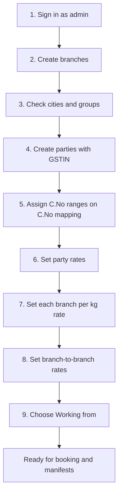
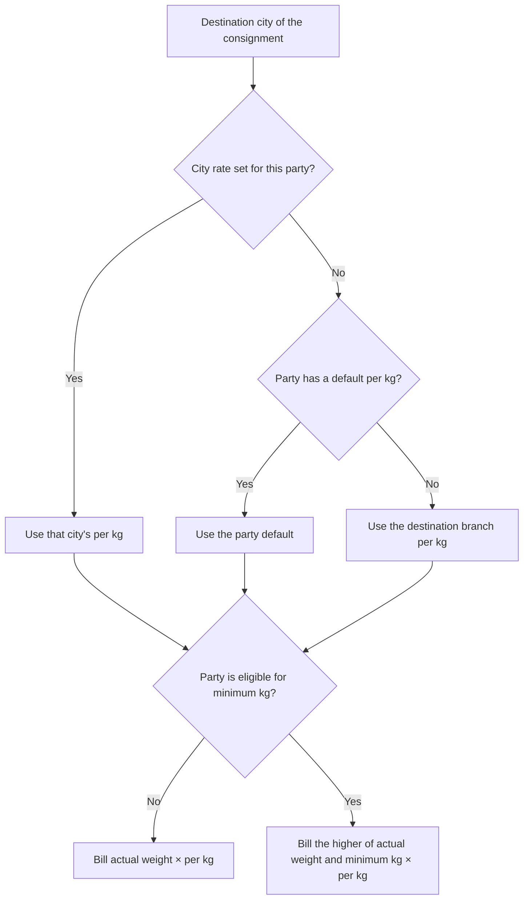
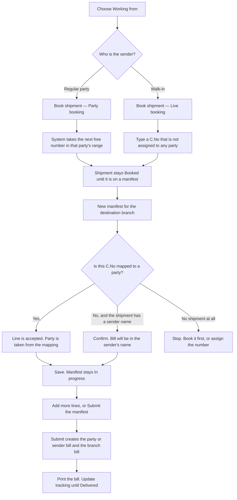
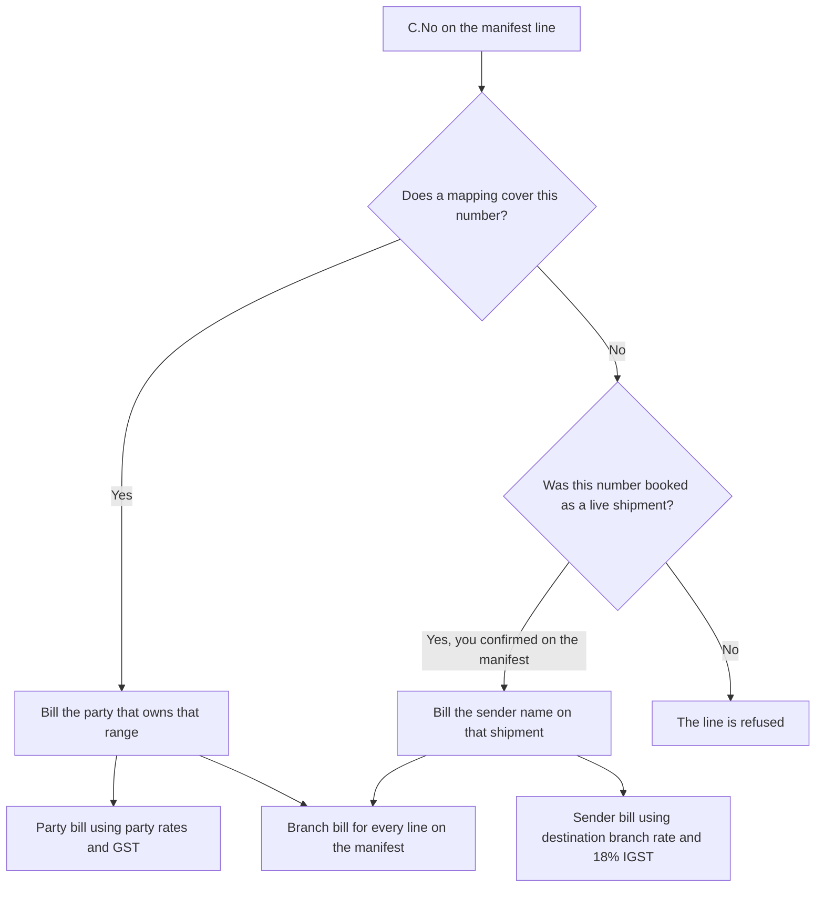

# Express Corporation of India — Operations guide

This guide is for the people who run the courier office. It explains what must exist before daily work, and the path one consignment takes from booking to the printed bill.

Open the admin console at `http://localhost:8080/admin` after signing in.

Default office login (change this password before a real handover):

| | |
|---|---|
| Email | `admin@expresscorporation.com` |
| Password | `Admin@123` |

Staff and admin accounts can use the office screens. A customer account can only book and see its own shipments on the public site.

---

## 1. What the application does

The office uses one chain:

**Branch and city network → Party → Consignment number → Rates → Booking → Manifest → Bill → Tracking**

A consignment number (C.No) is the tracking number. The party printed on a bill comes from the C.No mapping, not from a party chosen on the manifest.

Two bills are created when a manifest is submitted:

- A **party bill** (or a **sender-name bill** when the number was never assigned to a party). This is what you give the customer.
- A **branch bill**. This is the internal charge from the origin branch to the destination branch.

---

## 2. What is already there on a fresh start

| Already loaded | You create these yourself |
|---|---|
| Admin user | Branches |
| 433 Indian cities, each stored with its state and a rate group | Parties, with GSTIN |
| | C.No assignments |
| | Party rates and branch rates |
| | Shipments, manifests, and bills |

City groups, set the first time a city is stored:

| Group | Cities |
|---|---|
| Local | Indore |
| MP | Other Madhya Pradesh cities |
| CG | Chhattisgarh |
| Nearby States | Maharashtra, Gujarat, Rajasthan, Uttar Pradesh |
| Rest of India | Every other state |

A city you later edit keeps the group you saved. Restarting the application does not change it.

---

## 3. Prerequisites — do these once, in this order

Daily booking will not price or bill correctly until the steps below are done. Later steps depend on earlier ones.

### 3.1 Branches

Screen: **Network → Branches**.

Create every office that sends or receives consignments. Each branch needs a name, city, state, pincode, billing category, and a **per kg** rate.

- **Domestic** is the usual category for Madhya Pradesh.
- **National** is the usual category for Chhattisgarh.
- The per kg rate on the branch is the fallback price. Party bills use it when that party has no city rate and no default per kg. Branch bills use it when no lane rate has been set from the origin branch.

Two branches in the same city are allowed. When a price is looked up by city name, the first matching branch is used. Prefer one branch per city unless you have a reason to keep both.

### 3.2 Cities

Screen: **Network → Cities**.

The India list is already loaded. Use this screen to:

- Confirm Indore is **Local**, and that other cities sit in MP, CG, Nearby States, or Rest of India.
- Move a city to a different group when your commercial grouping differs from the state.
- Add a city that is missing from the list.

Party rates are entered by these groups. A city in the wrong group will show up on the wrong rate page.

### 3.3 Parties

Screen: **Parties → Parties**.

A party is a regular sender (the consignor), not a walk-in person. Required fields:

- Party name
- Phone
- City
- **GST number** — 15 characters, for example `23AAAAA0000A1Z5`. An existing party cannot be saved again until a valid GSTIN is entered.

Optional, and worth setting now:

- **Default per kg** — used for a destination city that has no rate of its own.
- **Eligible for minimum rate** — tick this only for parties who must be billed for a minimum weight. The kilogram figure itself is entered later under Party rates. Unticking the box stops the minimum from applying.

### 3.4 Consignment number allocation

Screen: **Parties → C.No mapping**.

This is the source of party billing. Assign one number, or a from–to range, to a party.

| Action | Rule |
|---|---|
| Assign | The range must not overlap a range already given to any party. Leave **To C.No** blank to assign a single number. |
| Search | By number or party name. |
| Change party | Allowed even after some numbers in the range have been used. The next bill uses the new party. |
| Delete | Allowed only while none of the numbers have been used on a shipment or a manifest. |

The same assignment can also be added from a party’s own page. Both screens write the same mapping. Use **C.No mapping** when you want to see every party in one list.

A number that is not in any range is a live (walk-in) number. It can still be booked, and it is billed under the sender’s name after you confirm that on the manifest.

### 3.5 Party rates

Screen: **Rates & bills → Party rates**.

1. Choose the party.
2. Choose a group: Local, MP, CG, Nearby States (MH / GJ / RJ / UP), or Rest of India.
3. Every city in that group is listed. Type the **per kg** rate for the cities this party uses.
4. **Apply one rate to the group** fills every city in that group with the same figure.
5. Set the **minimum kg** here if the party was tagged “Eligible for minimum rate”. A single city can have its own minimum kg; that city then uses its own figure and the other cities keep the party minimum.

Screen: **Rates & bills → Rate status** shows which cities have a rate and which are still blank.

How a party line is priced, in order:

Example. Party rate is ₹8 per kg and the minimum is 5 kg. A 3 kg parcel is billed as 5 × 8 = ₹40. The same parcel is ₹24 when the party is not tagged for a minimum.

A blank city rate is not an error. It falls through to the party default, then to the branch rate.

### 3.6 Branch rates

Do this in two places:

1. On **Branches**, set each branch’s own per kg rate.
2. On **Rates & bills → Branch rates**, choose the **base branch** (the office the goods leave from) and set the per kg rate to every other branch.

A branch is never a destination of itself. If a destination has no lane rate, the branch bill uses that destination branch’s own per kg rate. Shipments that stay in the same branch also use that branch’s own rate.

Party minimum kilograms are not applied on a branch bill. The branch bill uses the actual weight.

### 3.7 Working from

The **Working from** selector sits at the end of the office menu. It remembers which branch this user is sitting in.

That choice fills the origin city on a new booking and on a new manifest, and it decides which city is treated as Local on the manifest city list. Set it before the day’s bookings.

### 3.8 Users

Screen: **Office → Users**.

Create a staff login for each counter. Admin can change role, password, and whether the account is enabled.

---

## 4. End-to-end flow for one consignment

### 4.1 Book a shipment

Screen: **Daily work → Shipments → Book shipment** (`/admin/shipments/new`).

This is the counter. It is separate from the public **Book** page, which creates a customer shipment with a generated tracking id and does not use your C.No series.

Fill sender, receiver, origin, destination branch, weight, and number of boxes. Then choose one booking type.

**Party booking**

- The party list is shown. The C.No box is hidden.
- After you pick a party, the page shows the next free numbers in that party’s assigned sequence.
- Saving uses the next free number in that sequence.
- If the party has no range left, the office must assign one on C.No mapping before booking. When a party has no range at all, the screen tells you the next free number and that number is attached to the party as a single-number assignment.

**Live booking**

- The party list is hidden. The person is not stored as a party.
- Type the consignment number yourself.
- That number must not already belong to a party, and it must not already be used.
- The page shows **Next available Consignment Number**.
- The sender name typed here is the name that will appear on the bill if you later confirm an unmapped number on the manifest.

The shipment stays open (status **Booked**) until it is placed on a manifest.

### 4.2 Create the manifest

Screen: **Daily work → Manifests → New**.

There is no party field. Each line’s party is read from the C.No mapping when the manifest is billed.

For each line, either:

- pick an open shipment that was booked earlier, or
- type a consignment number, destination city, weight, and boxes.

Destination city is a search box. When the search matches exactly one city, that city is selected on its own. When several cities match, pick one from the list.

**Saving does not create the bill.** The manifest stays **In progress**. Saving again for the same destination branch adds the new lines onto the open manifest for that branch, instead of opening a second one.

**C.No not assigned to a party**

On save, the page asks you to confirm. The message names the sender. Choosing **Yes** keeps the line and, when you submit the manifest, bills it under that sender name. Choosing **Cancel** leaves the manifest unsaved.

If that number was never booked, there is no sender name to bill. Book the shipment first, or assign the number on C.No mapping, then add it.

### 4.3 Submit the manifest

On the manifest, **Submit** (finalize):

1. Marks the manifest **Created**. It can no longer be treated as an open draft.
2. Moves each linked shipment to **Dispatched**.
3. Creates the bills.

You can still correct a submitted manifest. If a bill is still **Pending**, saving the manifest recalculates that pending bill.

### 4.4 Bills

| Bill | Screen | Who it is for | Price used |
|---|---|---|---|
| Party bill, number `PTY-…` | Party bills | One bill per party on that manifest | Party city rate, then party default, then branch rate. Minimum kg applies only when the party is tagged. |
| Sender-name bill, also `PTY-…` | Party bills | One bill per sender name, for numbers with no party | Destination branch rate. Actual weight. No minimum kg. |
| Branch bill, number `BRN-…` | Branch bills | One bill for the whole manifest | Lane rate from the origin branch to each destination branch, otherwise that branch’s own per kg. Actual weight. |

Print a party or sender bill from its detail page. The heading is the party name, or the sender name. The GSTIN is printed under a party name.

**Bill date.** It starts as the last day of the manifest’s month. You can change it. Saving only the date leaves the freight amount as it is.

**Line columns:** Date, Consignment No, Destination, Weight, No of boxes, Rate, Amount. The line date is the manifest date.

**Tax** is calculated on the total freight, then a new grand total is shown:

| GSTIN | Tax |
|---|---|
| Starts with `23` | 9% SGST and 9% CGST, each rounded to paise |
| Any other GSTIN, or no GSTIN | 18% IGST |

A sender-name bill has no GSTIN, so it takes 18% IGST.

Mark a bill **Received** when the money is in, or return it to **Pending**.

### 4.5 Tracking

Screen: open the shipment, or the public page **Track** (`/track`). Anyone can track with the consignment number. No login is required.

Statuses you can set: Booked, Dispatched, Picked up, In transit, At hub, Out for delivery, Delivered, Cancelled, RTO.

A repeated save of the same status, place, and remarks within 10 minutes is ignored, so a double-click or a retry does not create a second event. A later update with a different place or remark is stored.

---

## 5. How one number becomes a bill

Several parties on one manifest produce several party bills and still one branch bill. Two unmapped numbers with the same sender name share one sender bill. Different sender names get separate bills.

---

## 6. A full example

Setup, done once:

1. Branch **Indore** at ₹5 per kg, branch **Gwalior** at ₹5 per kg.
2. On Branch rates, base branch Indore → Gwalior at ₹6 per kg.
3. Party **Sharma Traders**, GSTIN `23AAAAA0000A1Z5`, tagged for minimum rate, minimum 5 kg, Gwalior city rate ₹8 per kg.
4. C.No mapping: `120000–120099` assigned to Sharma Traders.

Day’s work:

1. Working from: Indore.
2. Party booking for Sharma Traders. The counter takes `120000` from that range.
3. A walk-in customer is booked as a live shipment, C.No `121500`, sender name **Ravi Jain**. `121500` is not in any party range.
4. New manifest, destination Gwalior. Add both numbers. `120000` is accepted quietly. `121500` asks for confirmation; you choose Yes.
5. Submit the manifest.

Result:

| Bill | Charged to | Basis |
|---|---|---|
| Party bill | Sharma Traders | Weight raised to 5 kg if the parcel is lighter, × ₹8. GSTIN starts with 23, so 9% SGST + 9% CGST. |
| Sender bill | Ravi Jain | Actual weight × ₹5 (Gwalior’s own rate, because this is not a party rate). 18% IGST. |
| Branch bill | Gwalior branch | Actual weight of both parcels × ₹6, the Indore → Gwalior lane rate. |

---

## 7. Other office screens

| Screen | What it is for |
|---|---|
| Dashboard | Counts for today, week, month, quarter, half-year, and year. |
| Reports | Booked, delivered, delivery rate, freight, and COD for a period. You can email the report if mail is configured. |
| Monitoring | Database and mail health, plus an alert check you can run by hand. |
| Notifications | Messages raised for the office. |
| Contacts | Messages sent from the public Contact page. Mark them read or delete them. |
| Public site | Home, About, Services, Branch list, Contact, Track, and a customer Book page. Customer booking does not use C.No mapping. |

---

## 8. Rules that are easy to miss

- Submit the manifest before you expect a bill. Saving a draft does not bill it.
- An in-progress manifest for a destination branch absorbs the next save for that same branch.
- Party booking spends the next free number inside the party’s range. Live booking must use a number outside every range.
- A used C.No range cannot be deleted. Change the party on the mapping if the number was assigned to the wrong party.
- Minimum kg applies only to a tagged party, and only on that party’s bill.
- Changing a rate affects the next bill calculation. A bill already marked Received is left as printed.
- The bill date is the month-end date, not the day you clicked Submit, until you edit it.
- Set **Working from** to the counter you are actually sitting at, so origin city and the Local group stay correct.

---

## 9. First-day checklist

- [ ] Change the admin password.
- [ ] Create every branch, with city and per kg rate.
- [ ] Confirm city groups, especially Indore as Local.
- [ ] Create each party with a real GSTIN. Tick minimum-rate only where the contract needs it.
- [ ] Assign each party’s C.No range on C.No mapping.
- [ ] Enter party city rates, then open Rate status and clear the gaps that matter.
- [ ] Enter branch-to-branch rates from each origin you dispatch from.
- [ ] Set Working from.
- [ ] Book one party shipment and one live shipment.
- [ ] Put both on a manifest, confirm the live number, submit, and print both bills.
- [ ] Track the party shipment to Delivered from the shipment page, and confirm the same timeline on the public Track page.
